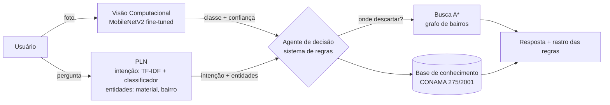

# ♻️ Descarte Inteligente — Maceió

Projeto Integrador Final — **Inteligência Artificial Aplicada** (AFYA • UNIMA Maceió, Prof. Icaro Ferreira)
Tema B — Identificação e classificação de resíduos.

**Integrantes:** Henrique de Moraes Belo Lopes (equipe de 1 pessoa)
**Repositório:** https://github.com/henrique-bees/residuos-ia
**Artigo (Overleaf):** https://www.overleaf.com/project/6afce9ccfddd89d11d81d8ae/share#786d039eed9eab936c4c1d4e0a29961643fc71ad89f190aa — rascunho em `artigo/main.tex` (conferir se compila e se cabe em 6 páginas)

## Problema

Grande parte do resíduo reciclável vai para o lixo comum porque as pessoas não sabem
identificar o material, em qual lixeira descartar nem onde entregá-lo. O sistema recebe
**a foto de um resíduo e uma pergunta em linguagem natural** e responde de forma contextualizada:
qual é o material, se é reciclável, como preparar, a cor da lixeira e o ponto de coleta mais próximo.

## Arquitetura



| Requisito do enunciado | Onde está |
|---|---|
| 4.1 Agentes / busca / regras | `src/decisao/agente.py` (regras R0–R16), `src/decisao/grafo.py` (A*, custo uniforme, BFS) |
| 4.2 Machine Learning | CNN com transfer learning (`src/visao_computacional/`), baseline HOG + SVM (`src/machine_learning/baseline_svm.py`), classificador de intenções (`src/pln/intencoes.py`) |
| 4.3 Visão Computacional | Classificação de imagens em 6 classes (TrashNet) |
| 4.4 PLN | Reconhecimento de intenções + extração de entidades (material e bairro) |
| 4.5 Integração | `app.py`: imagem e pergunta no mesmo fluxo; o agente combina as duas |

### Como o agente decide

1. **Material:** se a pergunta cita um material (“essa lata…”), o texto tem prioridade (R3) e
   divergências com a visão são registradas (R4). Senão usa a CNN: confiança < 60% → pede
   nova foto (R6); margem entre 1ª e 2ª classe < 15% → responde com ressalva (R8).
2. **Intenção:** `identificar`, `reciclavel`, `como_descartar`, `cor_lixeira`, `onde_descartar`,
   `saudacao` ou `fora_escopo` (abaixo de 35% de confiança vira fora de escopo).
3. **Onde descartar:** A* no grafo de bairros até o ponto que aceita o material. A heurística
   (menor distância em linha reta até qualquer ponto válido) é admissível, então a rota é ótima.

Cada resposta traz a lista de regras disparadas (aparece no app em “Como o agente decidiu”).

## Instalação

```bash
python -m venv .venv && source .venv/bin/activate   # Windows: .venv\Scripts\activate
pip install -r requirements.txt
```

## Execução (reprodutível, semente 42)

```bash
# 1. Dados de imagem (TrashNet) — baixa e divide 70/15/15 estratificado
python -m src.visao_computacional.dataset --baixar --dividir

# 2. Visão Computacional: CNN (≈ 20–40 min em CPU; use o Colab com GPU se puder)
python -m src.visao_computacional.treinar --epocas 8 --epocas-ft 6

# 3. Baseline de ML clássico para comparação
python -m src.machine_learning.baseline_svm

# 4. PLN: compara 3 classificadores de intenção e salva o melhor
python -m src.pln.intencoes

# 5. Experimento de busca (A* x custo uniforme x BFS)
python -m src.decisao.experimento_busca

# 6. Testes e aplicação
pytest testes -q
streamlit run app.py

# 7. Opcional: teste de campo (fotos reais, fora do domínio do TrashNet)
# Coloque ~20 fotos por classe em dados/teste_campo/<classe>/ e rode:
python -m src.visao_computacional.avaliar_campo
```

> Se o download automático falhar, baixe `dataset-resized.zip` em
> https://github.com/garythung/trashnet (pasta `data/`), coloque em `dados/` e rode de novo.

## Dados

| Dado | Origem | Observações |
|---|---|---|
| Imagens | TrashNet (Thung & Yang, 2016): ~2.500 fotos, 6 classes | Verificar a licença no repositório original. Imagens corrompidas são descartadas no carregamento. |
| Frases de intenção | `dados/intencoes.csv`: 146 frases escritas pela equipe + 150 geradas por IA (coluna `origem`) | 7 intenções, ≥ 40 frases cada. **Trocar as frases `gerado_ia` por frases reais de colegas** (gírias, erros de digitação) tende a melhorar ainda mais a generalização. |
| Mapa | `dados/mapa_maceio.json` | **Simulado**: coordenadas aproximadas dos bairros e pontos de coleta fictícios. |

## Resultados

Os arquivos ficam em `resultados/` (métricas em JSON/CSV), `resultados/graficos/`
(matrizes de confusão, curvas de treino, comparação de busca, diagrama da arquitetura) e
`resultados/exemplos/` (8 exemplos reais de entrada/saída, ver `exemplos.md`).

| Módulo | Métrica | Resultado |
|---|---|---|
| CNN MobileNetV2 (teste) | acurácia / F1-macro | 0,87 / 0,86 |
| Baseline HOG + SVM (teste) | acurácia / F1-macro | 0,70 / 0,70 |
| Intenções — melhor modelo (CV 5 folds) | F1-macro | 0,88 ± 0,06 (SVM linear) |
| Intenções (teste, 25%) | acurácia / F1-macro | 0,93 / 0,94 |
| Busca A* | nós expandidos (média) / % ótimo | 3,1 / 100% (custo uniforme: 4,8 / 100%; BFS: 4,6 / 75%) |
| CNN — teste de campo (12 fotos reais, fora do TrashNet) | acurácia / F1-macro | 0,42 / 0,36 (taxa de recusa 25%; acurácia entre respostas aceitas: 0,56) |

## Limitações

- O TrashNet tem fotos com fundo branco e um objeto por imagem; fotos reais (fundo poluído,
  vários objetos) reduzem bastante a acurácia — confirmado com 12 fotos reais de campo:
  acurácia caiu de 0,871 para 0,417 (ver `resultados/metricas_cnn_campo.json`). A classe mais
  afetada foi "rejeito" (lixeira com lixo orgânico misto, 0% de acerto — um tipo de cena muito
  diferente do TrashNet) e "plástico" (garrafas PET confundidas com vidro). Amostra pequena;
  o ideal é ampliar pra ≈ 20 fotos por classe.
- O dataset de intenções mistura frases escritas pela equipe com frases geradas por IA
  (marcadas em `origem=gerado_ia` no CSV); a melhora de F1 (0,70 → 0,94) reflete em parte
  textos mais parecidos entre si (o classificador aprende um estilo mais previsível), não
  necessariamente a mesma robustez que frases reais e variadas de colegas trariam.
- O mapa e os pontos de coleta são simulados; as distâncias são aproximações (linha reta × fator viário).
- Itens de descarte especial (pilhas, eletrônicos, óleo, lâmpadas) não estão entre as classes.

## Estrutura

```
app.py                       interface Streamlit (fluxo integrado)
src/config.py                caminhos, classes e limiares
src/visao_computacional/     dataset, modelo, treino e inferência da CNN
src/machine_learning/        baseline HOG+SVM e métricas/gráficos compartilhados
src/pln/                     pré-processamento, intenções e entidades
src/decisao/                 agente (regras), base de conhecimento, A*/BFS e experimento
dados/                       intenções, mapa e (após download) imagens
testes/                      testes automatizados (pytest)
resultados/                  métricas, gráficos e exemplos
artigo/                      fonte LaTeX do artigo (cópia do Overleaf)
```

## Referências

- THUNG, G.; YANG, M. *Classification of Trash for Recyclability Status*. CS229 Project Report, Stanford, 2016.
- SANDLER, M. et al. *MobileNetV2: Inverted Residuals and Linear Bottlenecks*. CVPR, 2018.
- HART, P.; NILSSON, N.; RAPHAEL, B. *A Formal Basis for the Heuristic Determination of Minimum Cost Paths*. IEEE Trans. SSC, 1968.
- DALAL, N.; TRIGGS, B. *Histograms of Oriented Gradients for Human Detection*. CVPR, 2005.
- BRASIL. CONAMA. *Resolução nº 275, de 25 de abril de 2001* (código de cores da coleta seletiva).
