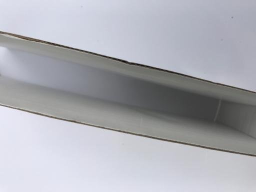
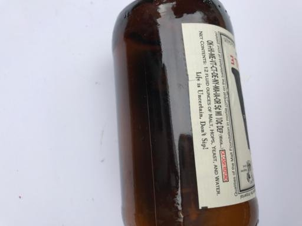
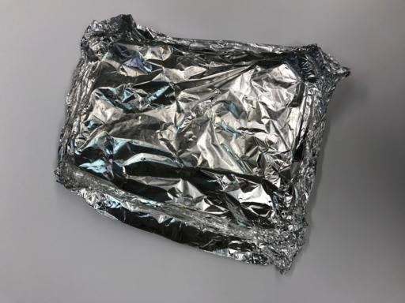
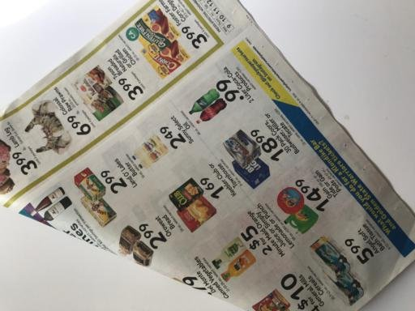
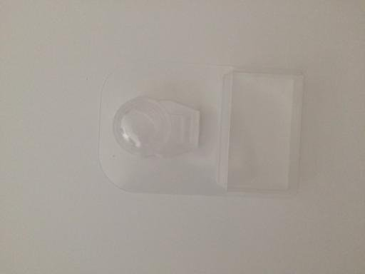
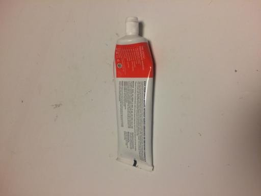
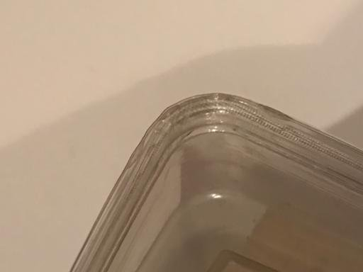
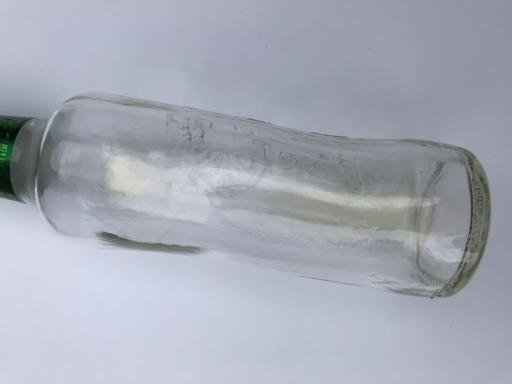

# Exemplos de entrada e saída

Gerados automaticamente a partir de imagens reais do conjunto de **teste** (nunca usadas no treino) e perguntas em linguagem natural, passando pelo pipeline completo (CNN + PLN + agente de regras + A\*).

## Exemplo 1: papelão

- **Classe real (pasta do TrashNet):** cardboard (papelão)
- **Classe prevista pela CNN:** paper (papel), confiança 67%, margem 46%
- **Pergunta:** 'o que é isso?'
- **Resposta do agente:** Parece ser **papel** (67% de confiança).
- **Material usado na decisão:** paper (fonte: visao)
- **Regras disparadas:**
  - R7: material pela visão (67%)
  - R9: responder identificação

## Exemplo 2: vidro

- **Classe real (pasta do TrashNet):** glass (vidro)
- **Classe prevista pela CNN:** glass (vidro), confiança 79%, margem 69%
- **Pergunta:** 'isso é reciclável?'
- **Resposta do agente:** Sim, **vidro** é reciclável — vai na coleta seletiva.
- **Material usado na decisão:** glass (fonte: visao)
- **Regras disparadas:**
  - R7: material pela visão (79%)
  - R10: consultar base sobre reciclabilidade

## Exemplo 3: metal

- **Classe real (pasta do TrashNet):** metal (metal)
- **Classe prevista pela CNN:** metal (metal), confiança 100%, margem 100%
- **Pergunta:** 'como eu descarto isso?'
- **Resposta do agente:** **Metal**: Enxágue latas e amasse para reduzir volume. Latas de tinta, aerossóis e pilhas exigem descarte especial — não vão na coleta comum.
- **Material usado na decisão:** metal (fonte: visao)
- **Regras disparadas:**
  - R7: material pela visão (100%)
  - R12: orientações de preparo

## Exemplo 4: papel

- **Classe real (pasta do TrashNet):** paper (papel)
- **Classe prevista pela CNN:** paper (papel), confiança 100%, margem 100%
- **Pergunta:** 'qual a cor da lixeira?'
- **Resposta do agente:** 🔵 Lixeira **azul** (papel).
- **Material usado na decisão:** paper (fonte: visao)
- **Regras disparadas:**
  - R7: material pela visão (100%)
  - R11: cor da lixeira (CONAMA 275/2001)

## Exemplo 5: plástico

- **Classe real (pasta do TrashNet):** plastic (plástico)
- **Classe prevista pela CNN:** plastic (plástico), confiança 94%, margem 91%
- **Pergunta:** 'onde eu levo isso?' (bairro: Pajuçara)
- **Resposta do agente:** O ponto mais próximo que recebe **plástico** é **Ecoponto Farol (simulado)**, a cerca de 3.7 km. Rota pelos bairros: Pajuçara → Poço → Farol.
- **Material usado na decisão:** plastic (fonte: visao)
- **Regras disparadas:**
  - R7: material pela visão (94%)
  - R15: A* a partir de Pajuçara (5 nós expandidos)
- **Rota (A\*):** Pajuçara → Poço → Farol

## Exemplo 6: rejeito (não reciclável)

- **Classe real (pasta do TrashNet):** trash (rejeito (não reciclável))
- **Classe prevista pela CNN:** trash (rejeito (não reciclável)), confiança 64%, margem 50%
- **Pergunta:** 'isso é reciclável?'
- **Resposta do agente:** Não. Isso é **rejeito** e deve ir no lixo comum (coleta domiciliar).
- **Material usado na decisão:** trash (fonte: visao)
- **Regras disparadas:**
  - R7: material pela visão (64%)
  - R10: consultar base sobre reciclabilidade

## Exemplo 7: plástico

- **Classe real (pasta do TrashNet):** plastic (plástico)
- **Classe prevista pela CNN:** plastic (plástico), confiança 68%, margem 37%
- **Pergunta:** 'garrafa pet é reciclável?'
- **Resposta do agente:** Sim, **plástico** é reciclável — vai na coleta seletiva.
- **Material usado na decisão:** plastic (fonte: texto)
- **Regras disparadas:**
  - R3: material citado no texto (“garrafa pet”) tem prioridade
  - R10: consultar base sobre reciclabilidade

## Exemplo 8: vidro

- **Classe real (pasta do TrashNet):** glass (vidro)
- **Classe prevista pela CNN:** glass (vidro), confiança 84%, margem 68%
- **Pergunta:** 'onde descartar esse material?' (bairro: Jatiúca)
- **Resposta do agente:** O ponto mais próximo que recebe **vidro** é **Ecoponto Jatiúca (simulado)**, a cerca de 0.0 km. Rota pelos bairros: Jatiúca.
- **Material usado na decisão:** glass (fonte: visao)
- **Regras disparadas:**
  - R7: material pela visão (84%)
  - R15: A* a partir de Jatiúca (1 nós expandidos)
- **Rota (A\*):** Jatiúca
